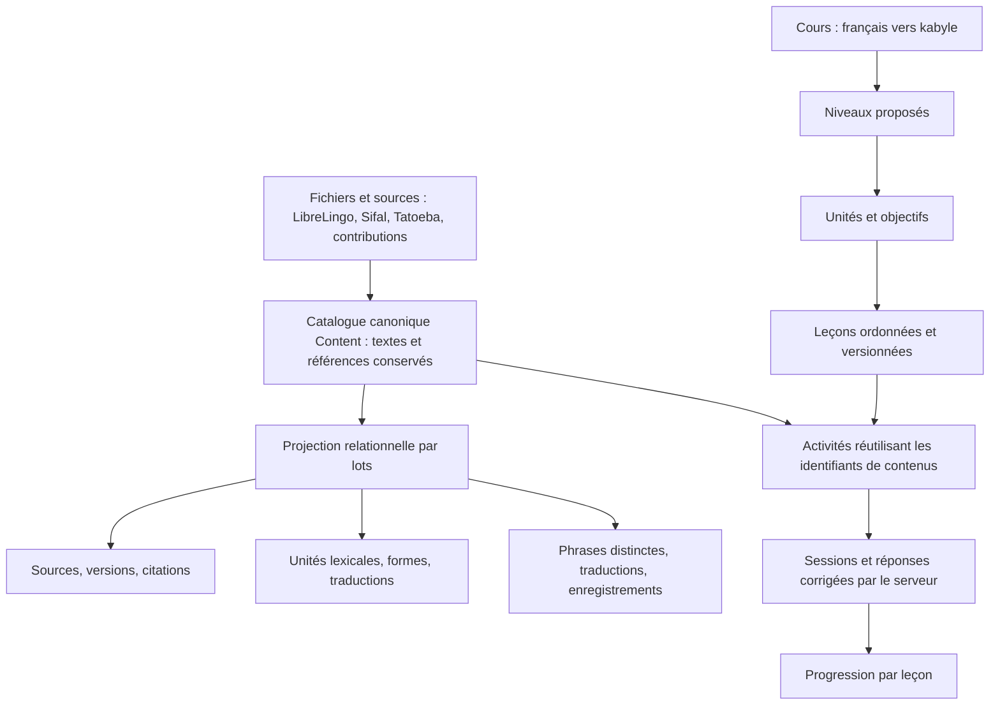

# Organiser le kabyle : du corpus à un parcours d’apprentissage

Une application de langues peut réutiliser les mêmes tables pour de nombreuses
langues : les langues sont des identifiants, et les cours relient une langue de
départ à une langue cible. Les phrases, traductions, médias, leçons et réponses
sont des lignes reliées par des clés. Il ne faut pas créer une application ou
une table entièrement différente pour chaque langue.

Le modèle ci-dessous est celui de ce projet, adapté à ce type d’application ;
il ne prétend pas reproduire la base interne de Duolingo.

## Trois couches séparées



1. **Le corpus** conserve les contenus collectés. Il peut contenir plusieurs
   traductions, variantes, sources et éléments à vérifier. Tout le corpus ne
   devient pas automatiquement une leçon.
2. **L’inventaire linguistique** regroupe les formes connues et organise les
   traductions, les enregistrements et les citations. Un regroupement reste
   proposé tant qu’il n’a pas été relu.
3. **Le parcours** choisit une petite sélection du corpus et la place dans un
   ordre pédagogique. Une activité référence le contenu existant, sans en
   recopier les textes dans une deuxième leçon opaque.

## Tables et responsabilités

| Ensemble | Tables | Rôle |
|---|---|---|
| Catalogue conservé | `content`, `media_asset` | Identifiants stables, textes originaux, statuts, catégories et médias existants |
| Langues | `language` | Codes et noms ; le premier cours relie `fra` à `kab` |
| Provenance | `corpus_source`, `source_snapshot`, `content_provenance` | Fournisseur, révision/empreintes disponibles, citations par contenu, anciennes citations conservées comme inactives |
| Lexique | `lexeme`, `lexeme_form`, `lexeme_translation`, `lexeme_content`, `form_evidence` | Sens connu ou entrée encore non résolue, forme principale proposée, variantes explicites, traductions et preuves dans le catalogue |
| Phrases | `sentence`, `sentence_translation`, `content_sentence` | Une même phrase kabyle peut avoir plusieurs traductions françaises et plusieurs contenus sources |
| Audio | `audio_recording`, `sentence_audio` | URL, auteur, licence et références depuis les phrases ; aucun fichier sonore n’est inventé ou téléchargé par cette normalisation |
| Traitement | `organization_job`, `content.structured_dirty` | Lots enregistrés, version de traitement et fiches restant à organiser |
| Pédagogie | `course`, `course_level`, `course_unit`, `course_lesson`, `lesson_activity`, `lesson_prerequisite` | Langues du cours, objectifs, ordre, références des activités et prérequis conseillés |
| Apprentissage | `lesson_run`, `lesson_activity_attempt` | Session anonyme, version des sources, résultats et leçons terminées |

`Content` reste le catalogue canonique et la couche de compatibilité des écrans
existants. Sa projection relationnelle est reconstruisible. Les anciens champs
JSON et les anciens exercices sont conservés ; cette migration n’efface pas les
imports, validations ou corrections de la plateforme.

Les unités lexicales utilisent les sens déjà connus pour regrouper les formes.
Les sens inconnus gardent une identité séparée, sans racine ni flexion kabyle
inventée. Les variantes explicites sont rattachées à leurs preuves. Une
correction remplace les preuves actives, sans servir l’ancienne forme comme
preuve actuelle. La nature grammaticale reste vide lorsqu’elle n’est pas fournie.

## Du contenu collecté à une leçon

Exemple du parcours pilote versionné :

- Cours : **Le kabyle, pas à pas**, depuis le français.
- Niveau proposé : **A1 — Premiers pas**.
- Unité : **Les animaux**.
- Leçon : **Trois animaux**, avec les fiches existantes de chien, chat et cheval.
- Activités : écrire les mots en kabyle, puis construire des phrases existantes
  dans la leçon suivante.

Le fichier `content/curriculum/kab-from-fr-v1.json` fixe les identifiants des
contenus, l’ordre, les objectifs et les recommandations. Il ne fabrique aucune
traduction. Il initialise **5 leçons A1 proposées**, dans quatre unités. Le
niveau A2 contient une unité à composer, pas un cours A2 prétendument complet.
L’admin permet ensuite de créer d’autres unités, leçons et niveaux jusqu’à C2.

Une phrase courte n’est pas nécessairement A1. `learning_band` et `token_count`
sont des indications de longueur. `cefr_level` ne devient un niveau relu que
lorsqu’une relecture est explicitement renseignée. Les niveaux du cours sont
des objectifs proposés, sans certification CECRL.

Le classement automatique du laboratoire combine le dictionnaire de catégories
et les contextes disponibles. L’association mot–phrase exige un mot kabyle
entier et le sens français correspondant, dans toute la base. Les variantes
inconnues restent à renseigner. Cette recherche reste utilisable avant, pendant
et après la projection relationnelle.

## Utilisation sur une installation existante

Arrêter les serveurs web avec Ctrl+C, récupérer le code puis compiler :

```bash
git pull --ff-only
npm --prefix frontend run build
```

Pour organiser tous les imports existants :

```bash
bash scripts/organize_data.sh
```

Ce script démarre le PostgreSQL du projet, applique la migration additive,
initialise le parcours et traite au maximum 500 fiches à la fois. Il enregistre
chaque lot et affiche le nombre de fiches restantes. Ctrl+C interrompt le lot
courant ; relancer la même commande reprend les fiches restantes.

```bash
bash scripts/start.sh
```

Le démarrage du site n’organise pas silencieusement les centaines de milliers
de phrases. Les ajouts/imports signalent les fiches à traiter via
`structured_dirty`. Les nouveaux mots du laboratoire sont organisés dans leur
transaction. Les gros imports peuvent ensuite être traités par le script ou
par l’admin. `--rebuild` reconstruit la projection à partir du catalogue sans
réimporter ni modifier les textes sources.

Dans **Gestion des contenus → Organiser les données et les parcours** :

- Charger les compteurs, lancer les lots et arrêter après le lot courant.
- Consulter un aperçu du lexique regroupé et de ses variantes.
- Composer ou modifier une leçon en recherchant les contenus existants.
- Ordonner les activités, choisir un niveau proposé et des prérequis conseillés.
- Exporter le plan actuel en JSON.

Dans **Mon parcours**, les unités et leçons sont accessibles publiquement. Les
prérequis sont des recommandations ; aucune leçon à vérifier n’est rendue
privée. Un contenu rejeté ou portant une incohérence connue rend sa leçon indisponible jusqu’à correction. Les fiches à clarifier restent consultables dans le corpus, mais ne sont pas proposées comme activités prêtes.

## Réponses et historique

Le serveur vérifie l’appartenance de l’activité à la session, la version de la
leçon et l’empreinte des sources. Il corrige les réponses avec les formes
attendues, conserve les résultats et ignore une répétition identique du même
identifiant d’essai. Le navigateur ne peut pas terminer une leçon en envoyant
simplement `completed: true`.

Toutes les activités doivent avoir été réussies pour terminer une session.
Cela décrit une leçon terminée, pas une maîtrise définitive de la langue.
Modifier la leçon crée une nouvelle révision et conserve les activités et essais
précédents. Une source modifiée exige une nouvelle session. La progression est
attachée au cookie anonyme actuel ; aucun compte multiappareil n’est encore
fourni. Effacer les progrès efface aussi les sessions de cours de cet élève.

Les anciens exercices gardent leur progression/révision de contenus. Il n’y a
pas de modèle adaptatif de type Birdbrain ni de calcul automatique fiable du
CECRL dans cette version.

## Reproductibilité : ce qui est garanti et ce qui doit être conservé

- Même catalogue canonique (identifiants et textes), même code et mêmes règles : mêmes identifiants de projection.
- Relancer l’organisation ne recrée pas les mêmes phrases, formes ou traductions.
- Les empreintes/révisions disponibles sont conservées ; l’absence de version
  est explicitement indiquée comme `unversioned`.
- Un hash ne remplace pas une archive. La normalisation ne récupère pas
  rétroactivement les anciens fichiers bruts et ne copie pas les audios distants.
- Garder les mêmes TSV/archives téléchargés est nécessaire pour rejouer un
  import externe à l’identique ; un nouveau téléchargement Tatoeba peut changer. Conserver aussi l’ordre des imports : lorsqu’une paire apparaît dans plusieurs sources, le premier import peut déterminer son identifiant canonique.
- Le plan JSON exporté décrit la pédagogie actuelle et ses références. Il
  n’exporte pas à lui seul toutes les données, corrections ou progressions.

Pour sauvegarder l’état complet de PostgreSQL :

```bash
bash scripts/backup_data.sh --container kabyle-postgres
```

Ou `bash scripts/backup_data.sh` si un `pg_dump` compatible est installé. Le
fichier `.dump` et son manifeste avec empreinte et commit sont écrits dans
`artifacts/backups/`, ignoré par Git. Les identifiants de connexion ne sont pas
imprimés. Les fichiers bruts, photos locales et médias distants doivent être
conservés séparément. Restaurer un dump doit se faire dans une base de
restauration distincte avant de remplacer une installation existante.

## Faire évoluer l’application

- Ajouter une langue : enregistrer son code, puis créer le cours correspondant
  et ses contenus traduits. Les interfaces d’édition restent centrées sur le
  cours français–kabyle pour l’instant.
- Ajouter une leçon ou un niveau : utiliser l’admin, sans réécrire une page React.
- Ajouter un type d’exercice : ajouter un type explicite, sa validation serveur,
  son rendu et ses tests ; les textes restent référencés par identifiant.
- Ajouter une extraction assistée par IA : garder la source, l’outil et sa
  version, enregistrer les propositions à vérifier, puis relire avant d’en faire
  des activités. Aucun appel à un LLM externe n’est nécessaire ni effectué ici.
- Le classement automatique et l’organisation technique aident à traiter le
  volume. La sélection des objectifs, la justesse du kabyle et la progression
  grammaticale demandent encore une relecture humaine.
